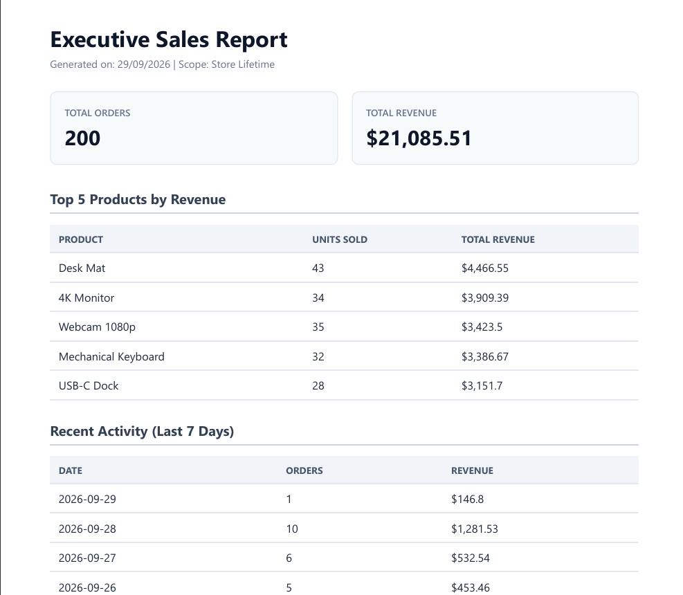

# PDF Report Generator API

An automated reporting pipeline built with Node.js, Express, SQLite (`node:sqlite`), and Playwright that aggregates sales order data into multi-page PDF documents and serves them by link.

## Dataset Selection
- **Option Selected**: Option A (The Little Shop orders database with 200 random seeded transactions).

## Installation & How to Run

1. Install dependencies:
   ```bash
   pnpm install
   pnpm exec playwright install chromium
   ```

2. Seed the SQLite database:
   ```bash
   pnpm run seed
   ```

3. Start the API server:
   ```bash
   pnpm run start
   ```

## Aggregation SQL Queries

```sql
-- 1. Total orders and total revenue
SELECT COUNT(*) as total_orders, ROUND(SUM(amount), 2) as total_revenue FROM orders;

-- 2. Top 5 products by revenue
SELECT product, ROUND(SUM(amount), 2) as revenue, COUNT(*) as count
FROM orders
GROUP BY product
ORDER BY revenue DESC
LIMIT 5;

-- 3. Daily orders breakdown for the last 7 days
SELECT DATE(created_at) as order_date, COUNT(*) as count, ROUND(SUM(amount), 2) as daily_revenue
FROM orders
WHERE created_at >= DATETIME('now', '-7 days')
GROUP BY DATE(created_at)
ORDER BY order_date DESC;
```

## Endpoint Reference

| Method | Endpoint | Description | Status Code |
|---|---|---|---|
| `GET` | `/health` | Server health check | 200 |
| `POST` | `/reports` | Generate report (Idempotent per day) | 201 / 200 |
| `GET` | `/reports/:id` | Fetch report metadata and file link | 200 / 404 |
| `GET` | `/reports/:id/file` | Download the generated PDF artifact | 200 / 404 |

## Generation & Download Verification

```bash
# Request report generation
curl -i -X POST http://localhost:3000/reports
# HTTP/1.1 201 Created
# {"id":1,"file":"/reports/1/file","cached":false,"created_at":"2026-09-29T02:00:00.000Z"}

# Download the file
curl -o final-report.pdf http://localhost:3000/reports/1/file
```

## Architectural Reflection Questions

### Stage 4: When should this work move out of the request?
I would move this work out of the HTTP request into a background job (such as via BullMQ or Inngest) as soon as rendering duration exceeds 1.5 seconds, data sets grow beyond several thousand rows, or multiple concurrent users request reports, because long synchronous HTTP requests tie up web workers and leave clients vulnerable to network gateway timeouts.

### Stage 5: Idempotency Protection
Checking for an existing report generated today prevents redundant headless Chromium launches and disk bloat when users rapidly double-click the generate button. In real-world enterprise applications, omitting idempotency checks can lead to charging a customer's credit card multiple times or sending duplicate automated invoice notification emails.

## Report Screenshot
